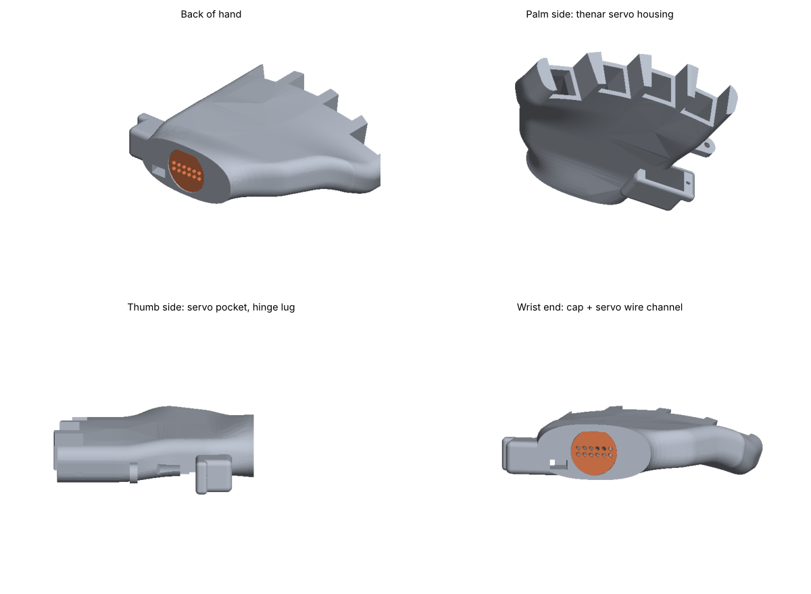

# Tendon-driven robotic hand

Building a tendon-driven robotic hand as a step toward prosthetics and
wearable robotics research. Based on the open-source
[InMoov](https://inmoov.fr) hand, with my own modifications.

Biomedical engineering, Georgia Tech.

## Goals

- [x] Print and assemble a single working finger
- [ ] Drive the finger with a servo and Arduino
- [ ] Build the full hand and forearm
- [x] Design my own parts: finger segments, ball-and-socket knuckle joint, palm
- [ ] Design my own mount and electrode holder
- [ ] Compare my finger design against the original for grip and range of motion
- [ ] Control the hand with an EMG (muscle) signal

## Status

**Stage 1 — first finger + palm.** Designed my own three-segment finger
(v1 → v2 → v5 knuckle joint), a ball-and-socket knuckle with tendon
routing for 1.25 mm tennis string, and a curved palm (v3) with a servo
housing for the thumb. Next: print the palm and one finger to test the
v5 joint, then the other three fingers.

See [`docs/build-log.md`](docs/build-log.md) for session notes.

## Repo layout

| Folder | Contents |
|---|---|
| `cad/personal cads/` | My designs, one folder per version (STL, plus STEP where available) |
| `cad/reference/` | InMoov STL files as printed (not my designs) |
| `code/` | Arduino sketches |
| `docs/` | Build log |
| `photos/` | CAD renders and build photos |

## Built with

- 3D printing at the Georgia Tech Invention Studio
- Autodesk Fusion for CAD
- Arduino for servo control

## Credit

Mechanical design based on the InMoov open-source humanoid robot by
Gael Langevin, licensed CC-BY-NC. Files in `cad/reference/` are his.
My own parts and code are in `cad/`, `code/`, and noted as mine in the
build log.
